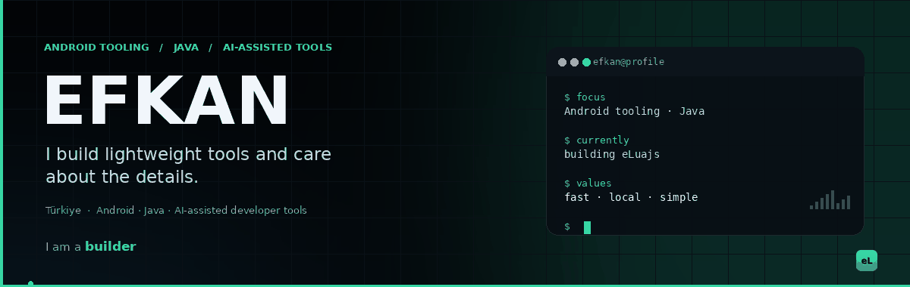

  

  

## About me

I’m **Efkan**, a developer from Türkiye.

I like building software that feels **quiet and deliberate**: it opens fast, does what it says, and doesn’t ask for attention. Most of my work lives around **Android tooling, Java and AI-assisted developer tools**, but the common thread is simpler than the technology:

**make it useful, keep it light, understand what’s underneath.**

I’m not trying to build a giant ecosystem. I’d rather make a few things that feel genuinely solid.

> “Sistemlerin en zayıf halkası her zaman insandır.”

---

## Mindset

<table>
  <tr>
    <td width="33%" valign="top">
      <h3>Lightweight</h3>
      
No unnecessary runtime layers. No waiting for the tool to load before the idea disappears.

    </td>
    <td width="33%" valign="top">
      <h3>Curious</h3>
      
I like going one level deeper: build systems, packaging, release flows, the parts behind the button.

    </td>
    <td width="33%" valign="top">
      <h3>Human control</h3>
      
AI should explain and automate the boring parts. The developer should stay in charge.

    </td>
  </tr>
</table>

---

## Right now

- Building **eLuajs**, a lightweight Android Java IDE for Linux and Windows.
- Learning more about Android builds, Gradle and release automation.
- Exploring safer AI-assisted editing and local-first workflows.
- Spending time on details that make tools feel calmer.

---

## Toolbox

  

---

## Beyond the screen

I care about clear interfaces, honest software and tools that respect the person using them.

I like small improvements more than big launches: a cleaner layout, a faster startup, a message that actually explains what went wrong.

---

  

  Build less. Ship faster. Stay lightweight.

